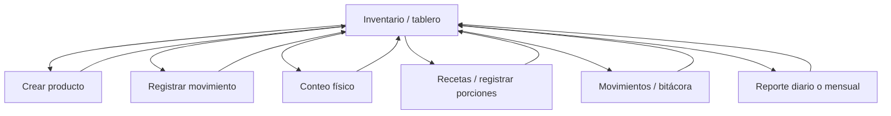

# Diseño de arquitectura MVC y experiencia de usuario

## Contexto y alcance

Pipiris Nais es un restaurante de comida mexicana. Esta aplicación controla únicamente el inventario del bar: bebidas, licores e insumos relacionados. No factura, no reemplaza el POS y no administra el inventario de cocina. La primera iteración permite mantener el catálogo, registrar entradas, consumos y mermas, capturar conteos físicos y consultar movimientos e indicadores mensuales.

## 1. Arquitectura MVC

### 1.1 Modelos

- `InventoryProduct`: producto, categoría, presentación, unidad, existencia, mínimo, costo y ubicación.
- `InventoryMovement`: historial auditable de entradas, consumos, mermas y ajustes de conteo; registra producto, cantidad, motivo, fecha y usuario.
- `Recipe` y `RecipeIngredient`: receta y cantidades base requeridas por porción.
- `InventoryDashboardViewModel`: datos agregados para el tablero, sin exponer reglas de negocio a la vista.
- `MovementInputViewModel`, `PhysicalCountInputViewModel`, `ProductInputViewModel` y `RecipeConsumptionInputViewModel`: contratos de entrada validados para cada formulario.
- `ReportsViewModel`: resumen de actividad del período solicitado.

La existencia actual se actualiza a partir de movimientos aceptados. Los movimientos de consumo y merma no pueden dejar el saldo negativo. Cada producto define cuántas unidades base contiene su presentación de inventario (por ejemplo, 25.36 oz por botella); la receta usa unidades base y el sistema convierte el consumo a la presentación almacenada. En una siguiente fase, las entidades persistirán en una base relacional mediante Entity Framework Core.

### 1.2 Vistas

- `Views/Inventory/Index.cshtml`: tablero de existencias, alertas, filtros, actividad reciente, captura de movimiento y conteo físico.
- `Views/Inventory/CreateProduct.cshtml`: alta de producto con unidad, presentación y stock mínimo.
- `Views/Inventory/Recipes.cshtml`: recetas de demostración y registro manual de porciones preparadas.
- `Views/Inventory/Movements.cshtml`: bitácora completa de movimientos.
- `Views/Inventory/Reports.cshtml`: resumen diario o mensual de entradas, consumos y mermas.
- `Views/Shared/_Layout.cshtml`: navegación persistente, identidad visual del restaurante y contenido responsive.

### 1.3 Controladores

`InventoryController` atiende las rutas de inventario, recetas, movimientos y reportes; recibe formularios, valida el modelo, llama al servicio de aplicación y decide qué vista o redirección devolver. `HomeController` queda solamente para la vista de error del template.

### 1.4 Relación entre componentes MVC


La vista presenta información y captura datos; el controlador coordina la petición HTTP; el servicio aplica reglas de negocio; los modelos representan conceptos y datos. La persistencia relacional se incorporará detrás del servicio, sin trasladar consultas a las vistas.

### 1.5 Organización del proyecto

```text
Controllers/       Rutas, validación de formularios y coordinación MVC
Models/            Entidades y ViewModels
Services/          Reglas del inventario y acceso a datos en fases posteriores
Views/Inventory/   Tablero, catálogo, recetas, movimientos y reportes
Views/Shared/      Layout compartido
wwwroot/           CSS y JavaScript del cliente
docs/              Arquitectura, UX, historias y casos de uso
```

En esta iteración, `InventoryService` mantiene datos de demostración en memoria. Al reiniciar la aplicación, los cambios se pierden; no se debe usar aún como sistema productivo. La siguiente fase reemplazará el almacenamiento temporal por Entity Framework Core y una base de datos relacional.

## 2. Diseño UX

### 2.1 Usuarios

- **Gerente/administrador:** configura el catálogo y mínimos, revisa costos, discrepancias y reportes; autoriza ajustes y decisiones de reposición.
- **Encargado de bar/bartender:** consulta existencias y registra entradas recibidas, consumos, mermas y conteos al cierre del turno.

Los roles son parte del diseño funcional. La autenticación y autorización por permisos se implementarán en la fase de seguridad; el prototipo actual muestra el perfil operativo como referencia y todavía no restringe acciones por usuario.

### 2.2 Historias de usuario

| ID | Historia | Prioridad |
|---|---|---|
| HU-01 | Como encargado, quiero registrar la recepción de productos con cantidad y motivo para actualizar las existencias del bar. | Alta |
| HU-02 | Como encargado, quiero registrar consumo o merma para que el sistema descuente cantidades y conserve trazabilidad. | Alta |
| HU-03 | Como gerente, quiero ver alertas de productos en o bajo el mínimo para planificar la reposición. | Alta |
| HU-04 | Como encargado, quiero ingresar el conteo físico y compararlo con el saldo teórico para identificar faltantes o sobrantes. | Alta |
| HU-05 | Como gerente, quiero consultar movimientos y reportes diarios o mensuales para analizar el consumo y las pérdidas. | Media |
| HU-06 | Como gerente, quiero crear productos y definir unidad, presentación y stock mínimo para adaptar el catálogo a la operación. | Media |
| HU-07 | Como bartender, quiero descontar insumos de acuerdo con una receta para estandarizar el consumo de bebidas preparadas. | Alta |
| HU-08 | Como gerente, quiero que el sistema sugiera una requisición a partir del consumo promedio para reducir quiebres de stock. | Baja, fase siguiente |

### 2.3 Flujos de navegación

1. **Registrar entrada/consumo/merma:** Inventario → Registrar movimiento → seleccionar tipo y producto → indicar cantidad y motivo → validar saldo → guardar → confirmar y actualizar tablero.
2. **Conteo de cierre:** Inventario → acción de conteo del producto → ingresar cantidad física → comparar con saldo teórico → registrar ajuste y mostrar confirmación.
3. **Alta de producto:** Inventario → Nuevo producto → completar datos y mínimo → validar → guardar → regresar al tablero.
4. **Registrar preparación:** Inventario → Recetas → indicar porciones → convertir unidades base a unidades de inventario → validar todos los ingredientes → registrar consumo y confirmar.
5. **Consultar actividad:** Inventario → Movimientos para la bitácora; Inventario → Reportes → elegir vista diaria o mensual.

### 2.4 Mapa de navegación



### 2.5 Casos de uso

#### CU-01 Registrar entrada de insumos

- **Actor principal:** encargado de bar; también puede hacerlo el gerente.
- **Precondiciones:** usuario autenticado y producto activo en el catálogo.
- **Flujo principal:** abre “Registrar movimiento”; elige “Entrada”; selecciona producto; ingresa cantidad y motivo; el sistema valida los datos, registra la operación y aumenta la existencia.
- **Alternativas:** si la cantidad es inválida o el producto no existe, el sistema no guarda y solicita corregir los datos.
- **Postcondición:** queda una entrada en la bitácora y el tablero refleja el nuevo saldo.

#### CU-02 Registrar consumo o merma

- **Actor principal:** encargado de bar.
- **Precondiciones:** producto activo y existencia suficiente.
- **Flujo principal:** selecciona “Consumo” o “Merma”; elige producto; captura cantidad y motivo; el sistema valida que no exceda la existencia; registra y descuenta.
- **Alternativas:** si la cantidad supera el saldo, se rechaza la operación y se informa la existencia disponible.
- **Postcondición:** el saldo y la bitácora quedan actualizados.
- **Nota de alcance:** la aplicación registra manualmente las porciones preparadas y descuenta los ingredientes por receta. La conexión automática con ventas del POS no está incluida porque el proyecto no contempla integración con ese sistema.

#### CU-03 Realizar conteo físico

- **Actor principal:** encargado de bar.
- **Flujo principal:** desde el producto abre el conteo, introduce la cantidad observada y confirma; el sistema compara con el saldo teórico y registra un ajuste si hay diferencia.
- **Alternativas:** si el valor no es válido o el producto no está activo, no se aplica el ajuste.
- **Postcondición:** la existencia queda conciliada y la diferencia aparece en la bitácora para revisión.

#### CU-04 Consultar reportes

- **Actor principal:** gerente.
- **Flujo principal:** abre Reportes; el sistema presenta el período actual y resume entradas, consumos y mermas, con detalle de movimientos.
- **Postcondición:** el gerente dispone de información para revisar consumo y reposición.

#### CU-05 Registrar preparación por receta

- **Actor principal:** bartender/encargado de bar.
- **Precondiciones:** receta e ingredientes configurados con unidades compatibles.
- **Flujo principal:** abre Recetas; selecciona una preparación e indica porciones; el sistema convierte cantidades base (por ejemplo, onzas) a unidades de stock (por ejemplo, botellas), valida todos los ingredientes y aplica los descuentos como movimientos de consumo.
- **Alternativas:** si algún ingrediente no tiene equivalencia válida o no hay saldo suficiente, se rechaza toda la preparación y se informa el producto faltante.
- **Postcondición:** se registran los consumos asociados a la receta y las existencias quedan actualizadas.

## Criterios de aceptación del prototipo

- El saldo no puede ser negativo por consumo o merma.
- Todo cambio de existencia debe crear un movimiento con cantidad, fecha y motivo.
- Las recetas convierten porciones a unidades de stock y validan disponibilidad de todos sus ingredientes antes de descontar cualquiera.
- Un producto se marca para reposición cuando su existencia es menor o igual al mínimo.
- El tablero, la bitácora y los reportes diario/mensual se actualizan al registrar operaciones.
- Los formularios deben funcionar en pantalla táctil y móvil, con etiquetas accesibles y mensajes de validación.