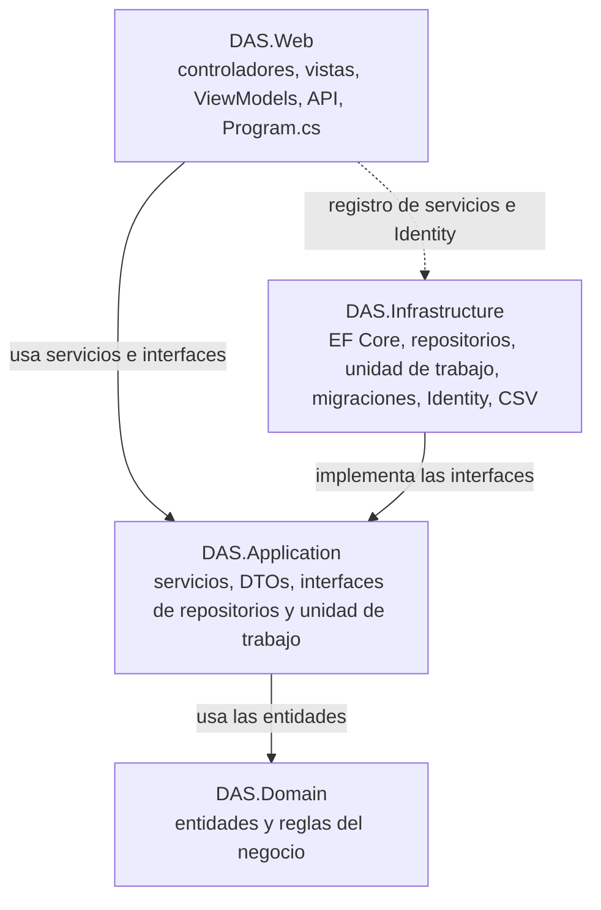
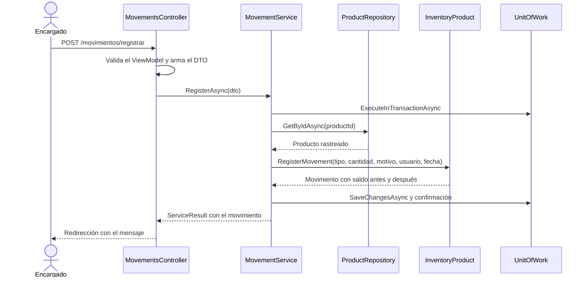

# Guía de arquitectura

Esta guía explica cómo está organizada la solución `DAS.sln` y dónde va cada cambio nuevo. El documento de la Etapa 3 desarrolla el porqué de cada decisión; aquí está lo necesario para trabajar en el código.

## Capas y dependencias



Reglas que no se rompen:

- `DAS.Domain` no referencia ningún proyecto ni paquete.
- `DAS.Application` solo referencia a `DAS.Domain`. No conoce Entity Framework, HTTP ni Razor.
- `DAS.Infrastructure` implementa las interfaces que define `DAS.Application`.
- `DAS.Web` usa `DAS.Infrastructure` solo en `Program.cs` (registro de dependencias) y en las pantallas de cuentas (usuario de Identity). Ningún controlador del inventario recibe `AppDbContext` ni un repositorio.

Las pruebas de `tests/DAS.Tests/Architecture` revisan estas reglas en cada ejecución.

## Qué contiene cada proyecto

| Proyecto | Carpetas |
|---|---|
| `DAS.Domain` | `Entities` (InventoryProduct, InventoryMovement, Recipe, PhysicalCount), `Enums`, `Catalogs`, `Exceptions`, `Common` |
| `DAS.Application` | `Abstractions/Persistence` (repositorios y unidad de trabajo), `Abstractions` (ICurrentUser, IReportExporter), `Services` y `Services/Interfaces`, `DTOs`, `Mappings` (entidad a DTO), `Security` (AppRoles), `Common` (ServiceResult) |
| `DAS.Infrastructure` | `Persistence` (AppDbContext, `Configurations`, `Repositories`, `Interceptors`, `Seed`), `Migrations`, `Identity`, `Reports` (CsvReportExporter) |
| `DAS.Web` | `Controllers`, `Views`, `Models` (ViewModels, Auth, Validation), `Mappings` (ViewModel a DTO), `Security` (HttpCurrentUser), `Extensions`, `Configuration`, `wwwroot` |
| `DAS.Tests` | `Unit`, `Integration`, `Functional`, `Architecture`, `Fakes` |

## Recorrido de una petición

Ejemplo: un encargado registra un consumo desde el tablero.



## Repositorios y unidad de trabajo

- `IReadRepository<T>` lee y `IRepository<T>` agrega `Add`, `Update` y `Remove`. Cada entidad principal tiene su interfaz (`IProductRepository`, `IMovementRepository`, `IRecipeRepository`, `IPhysicalCountRepository`) con sus consultas propias.
- Los repositorios no guardan. Los cambios se confirman con `IUnitOfWork.SaveChangesAsync`, que guarda en una sola operación lo que agregaron todos los repositorios de la petición.
- `GetByIdAsync` devuelve la entidad rastreada: basta cambiarla y guardar. Las listas que solo se muestran se leen con `AsNoTracking`.
- Una operación de varios pasos va dentro de `ExecuteInTransactionAsync`. Si algo falla, se revierte todo y el contexto queda limpio.

```csharp
var result = await unitOfWork.ExecuteInTransactionAsync(async token =>
{
    var product = await products.GetByIdAsync(input.ProductId, token);
    if (product is null || !product.IsActive)
    {
        return ServiceResult<MovementDto>.Fail("Selecciona un producto activo.", nameof(RegisterMovementDto.ProductId));
    }

    var movement = product.RegisterMovement(input.Type, input.Quantity, input.Reason, currentUser.UserName, recordedAt);
    movements.Add(movement);
    await unitOfWork.SaveChangesAsync(token);
    return ServiceResult<MovementDto>.Ok(movement.ToDto());
}, cancellationToken);
```

## Servicios

- Un servicio es un caso de uso completo: valida, usa repositorios y confirma con la unidad de trabajo.
- Devuelve `ServiceResult<T>` para los errores esperados (dato inválido, existencia insuficiente). El controlador lo convierte en un mensaje junto al campo o en un aviso después de la redirección.
- Recibe abstracciones: repositorios, `IUnitOfWork`, `ICurrentUser` para saber quién registra y `TimeProvider` para la fecha. Así se prueba sin base de datos y con un reloj fijo.
- Las pantallas que solo consultan productos dependen de `IProductQueryService`; las que modifican el catálogo, de `IProductService`.

## Reglas del dominio

- La existencia solo cambia con un movimiento: `InventoryProduct.Stock` tiene setter privado y se modifica con `RegisterMovement` (entrada, consumo, merma) o `AdjustToCount` (ajuste del conteo físico).
- Un saldo negativo lanza `InsufficientStockException`, aunque un servicio olvide validarlo.
- Los movimientos son inmutables (`init`): forman el kardex del producto.
- Un producto con historial no se elimina; se desactiva.

## Registro de dependencias

Cada capa registra lo suyo con un método de extensión y `Program.cs` solo los compone:

```csharp
builder.Services
    .AddApplication()
    .AddInfrastructure(builder.Configuration)
    .AddWebPresentation(builder.Configuration)
    .AddWebSecurity(builder.Configuration, builder.Environment);
```

| Registro | Ciclo de vida |
|---|---|
| Servicios, repositorios, unidad de trabajo, `AppDbContext` | Scoped: comparten el contexto durante la petición |
| `ICurrentUser` (HttpCurrentUser) | Scoped |
| `IReportExporter` (CsvReportExporter), `TimeProvider` | Singleton |

## Pruebas

```powershell
dotnet test
dotnet test --filter "FullyQualifiedName~DAS.Tests.Unit"
dotnet test --filter "FullyQualifiedName~DAS.Tests.Functional"
```

| Carpeta | Qué usa |
|---|---|
| `Unit/Domain` | Solo las entidades |
| `Unit/Application` | Servicios reales con repositorios en memoria (`Fakes`) y reloj fijo |
| `Unit/Infrastructure` | El exportador CSV |
| `Integration` | EF Core con SQLite en memoria y las migraciones reales |
| `Functional` | La aplicación completa con `WebApplicationFactory`; el encabezado `X-Rol-Prueba` simula la sesión de un Admin, un Encargado o una cuenta de Consulta |
| `Architecture` | Reflexión sobre los ensamblados para revisar las dependencias |

Si cambias una entidad y olvidas la migración, falla `Migraciones_SeAplicanYElModeloNoTieneCambiosPendientes`.

## Agregar una funcionalidad de punta a punta

1. Regla o dato nuevo: método o propiedad en la entidad de `DAS.Domain/Entities`.
2. Tabla o columna: configuración en `DAS.Infrastructure/Persistence/Configurations` y una migración:
   `dotnet ef migrations add Nombre --project src/DAS.Infrastructure --startup-project src/DAS.Web`
3. Consulta LINQ: método en la interfaz del repositorio (`DAS.Application/Abstractions/Persistence`) y su implementación en `DAS.Infrastructure/Persistence/Repositories`.
4. Caso de uso: método en el servicio y su interfaz, con DTOs de entrada y salida.
5. Pantalla: acción del controlador, ViewModel con sus validaciones, mapeo en `DAS.Web/Mappings` y vista Razor.
6. Pruebas: unitaria del servicio con los repositorios en memoria y, si toca la base o HTTP, de integración o funcional.

## Convenciones

- Código asíncrono de punta a punta, con `CancellationToken` en cada acción y método de repositorio.
- Roles con las constantes de `AppRoles` (`[Authorize(Roles = AppRoles.Operadores)]`); en las vistas, `User.CanManageInventory()`.
- Clases y métodos en inglés, como el código existente; mensajes al usuario y nombres de pruebas en español.
- Comentarios solo donde explican una decisión que el código no muestra, escritos así: `//La existencia se lee en la misma transacción`.
