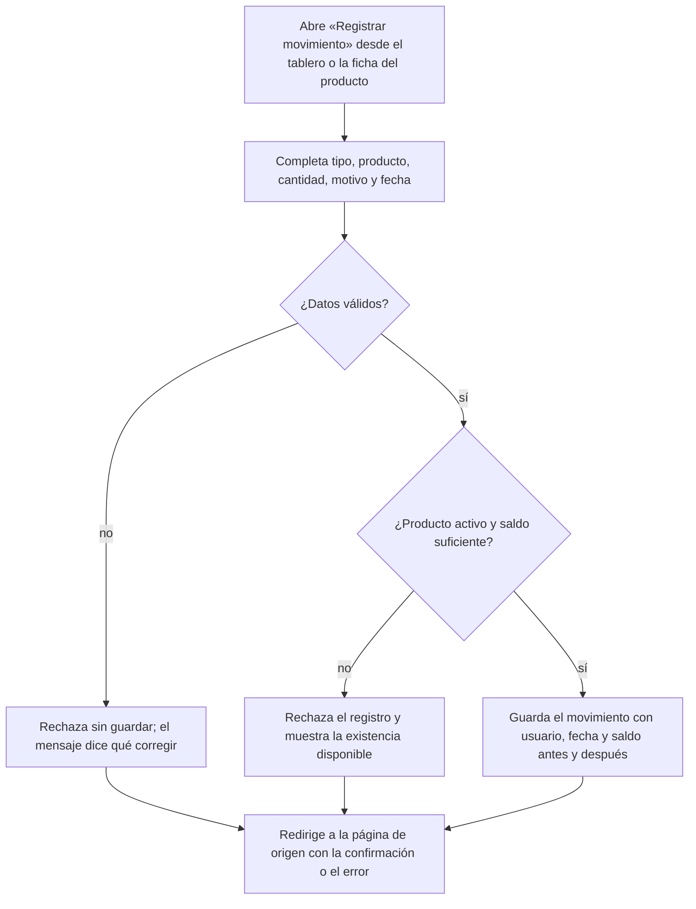
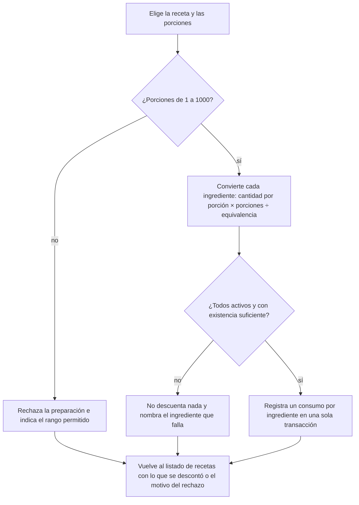
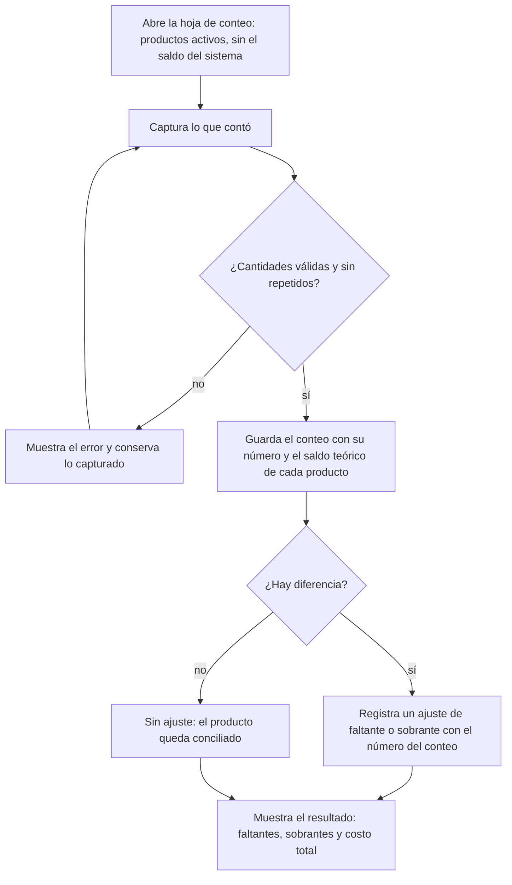
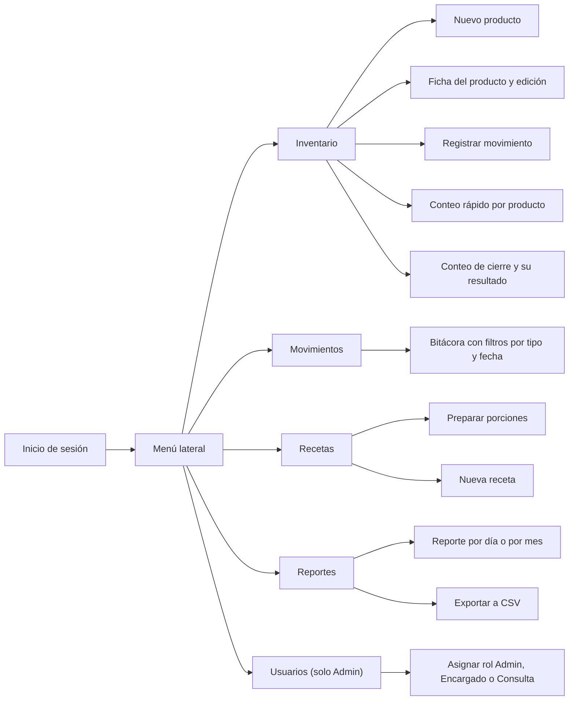

# Experiencia de usuario

Esta versión reemplaza la sección de UX de la Fase 2. Las historias se escribieron a partir de lo que dijo el cliente y de lo que se observó en el restaurante, y después se construyó y se probó:

1. Investigar: entrevistas y observación directa (Fase 1).
2. Extraer necesidades con su evidencia.
3. Definir perfiles a partir de esas necesidades.
4. Escribir historias con prioridad y criterios de aceptación.
5. Dibujar los flujos y diseñar las pantallas.
6. Construir y comprobar cada criterio con pruebas automatizadas.

## 1. Lo que se aprendió de los usuarios

Fuentes: dos entrevistas con Carlos Argueta, director de operaciones (15 y 22 de agosto de 2026), y la observación del área de recepción (22 de agosto de 2026). Hoy las requisiciones se piden y quedan registradas en WhatsApp, y el control se lleva en papel.

| Id | Necesidad | Evidencia (Fase 1) |
|---|---|---|
| N1 | Registrar la entrada con la cantidad realmente recibida | Entrevista 1, necesidades 2 y 3; la observación confirma que se verifica lo recibido |
| N2 | Descontar el consumo según las recetas | Entrevista 1, necesidad 4 (ejemplo: 4 oz por orden) |
| N3 | Registrar mermas y conservar su historial | Entrevista 2, necesidades 4 a 8 |
| N4 | Consultar la existencia disponible y saber qué reponer | Entrevista 1, necesidad 5 |
| N5 | Comparar el inventario teórico con el físico | Entrevista 1, necesidad 6; observación, puntos 16 y 17 |
| N6 | Reportes diarios y mensuales | Entrevista 1, necesidad 7 |
| N7 | Dejar el papel y WhatsApp: datos confiables y trazables | Entrevista 1, necesidades 8 y 9; observación, punto 19 |
| N8 | Usar el consumo promedio para la próxima requisición | Entrevista 1, necesidades 10 y 11 |

La Fase 1 estudió las carnes; desde la Fase 2 el alcance es el bar. El proceso es el mismo (requisición, recepción, consumo por receta, merma, conteo y reporte), con otras unidades: botellas, galones y onzas.

## 2. Perfiles

| Perfil | Rol en el sistema | Objetivo | Problema actual | Necesidades |
|---|---|---|---|---|
| Director de operaciones o gerente | Admin | Saber cuánto se consume, cuánto se pierde y cuánto pedir | Datos dispersos en papel y WhatsApp; promedios calculados a mano | N4, N5, N6, N7, N8 |
| Encargado de bar | Encargado | Registrar entradas, salidas y el cierre sin errores durante el turno | Anota en papel y concilia al final del día | N1, N3, N5 |
| Bartender | Encargado | Que lo preparado se descuente solo, según la receta | Convierte onzas a botellas a mano | N2 |
| Personal de apoyo | Consulta | Ver si hay producto sin poder modificarlo | Debe preguntar al encargado | N4 |

## 3. Historias de usuario

| Id | Historia | Necesidad | Prioridad | Estado |
|---|---|---|---|---|
| HU-01 | Registrar la entrada con la cantidad recibida | N1 | Alta | Implementada |
| HU-02 | Registrar porciones de una receta | N2 | Alta | Implementada |
| HU-03 | Registrar consumos y mermas | N3 | Alta | Implementada |
| HU-04 | Ver productos en o bajo su mínimo | N4 | Alta | Implementada |
| HU-05 | Capturar el conteo de cierre y comparar | N5 | Alta | Implementada |
| HU-06 | Consultar y exportar reportes | N6 | Media | Implementada |
| HU-07 | Saber quién hizo cada movimiento | N7 | Media | Implementada |
| HU-08 | Mantener el catálogo de productos | N4 | Media | Implementada |
| HU-09 | Sugerir la próxima requisición | N8 | Baja | Pendiente |

### Criterios de aceptación

**HU-01.** Como encargado de bar, quiero registrar la entrada de producto con la cantidad realmente recibida, para que la existencia refleje lo que llegó.

- Dado un producto activo, cuando registro una entrada con cantidad mayor que cero y un motivo, entonces la existencia aumenta y la bitácora guarda mi usuario, fecha y hora.
- Dada una cantidad vacía o en cero, cuando guardo, entonces no se registra nada y el mensaje indica qué corregir.
- Dada una fecha pasada, cuando guardo, entonces el movimiento conserva ese día; una fecha futura no se acepta.

**HU-02.** Como bartender, quiero registrar las porciones preparadas de una receta, para no convertir onzas a botellas a mano.

- Dada una margarita con 2 oz de tequila y botellas de 25.36 oz, cuando registro 3 porciones, entonces se descuentan 0.2366 botellas de tequila y los demás ingredientes.
- Dado un ingrediente insuficiente, cuando registro la preparación, entonces no se descuenta ningún ingrediente y el mensaje nombra el faltante.
- Las porciones aceptadas van de 1 a 1000.

**HU-03.** Como encargado, quiero registrar consumos y mermas con su motivo, para saber qué salió y qué se perdió.

- Dado un producto con 2 botellas, cuando registro un consumo de 5, entonces se rechaza, el saldo sigue en 2 y el mensaje muestra lo disponible.
- Dada una merma válida, cuando la guardo, entonces el saldo baja y aparece como «Merma» en la bitácora y en el costo de pérdidas.

**HU-04.** Como gerente, quiero ver qué productos están en o bajo su mínimo, para decidir la reposición.

- Dado un producto con existencia menor o igual a su mínimo, cuando abro el tablero, entonces muestra «Reponer» y suma en «Bajo mínimo».
- Puedo buscar por nombre y filtrar por categoría sin recargar la página.

**HU-05.** Como encargado, quiero capturar el conteo de cierre sin ver el saldo del sistema, para comparar teórico contra físico sin sesgo.

- Dada la hoja de conteo, cuando ingreso cantidades solo para algunos productos, entonces solo esos se comparan.
- Dada una diferencia, cuando guardo, entonces se registra un ajuste de faltante o sobrante que cita el número de conteo, y el resultado muestra el costo de la diferencia.
- Un producto no puede aparecer dos veces en el mismo conteo.

**HU-06.** Como gerente, quiero consultar y exportar el reporte diario o mensual, para analizar consumo, pérdidas y su costo.

- Dado un día o un mes, cuando abro el reporte, entonces veo entradas, consumos, mermas y ajustes por producto, con costos.
- Los productos desactivados que tuvieron movimientos siguen en el reporte del período.
- El CSV descargado se abre en Excel con los acentos correctos.

**HU-07.** Como gerente, quiero saber quién hizo cada movimiento, para tener trazabilidad sin papel.

- Cada movimiento y conteo guarda la cuenta que inició sesión.
- Una cuenta con rol Consulta ve el inventario, pero no puede registrar ni editar.

**HU-08.** Como gerente, quiero dar de alta y editar productos, para adaptar el catálogo al bar.

- No se aceptan dos productos con el mismo nombre, sin distinguir mayúsculas.
- Editar un producto no cambia su existencia.
- Un producto con historial no se elimina: se desactiva y conserva su kardex.

**HU-09.** Como gerente, quiero una sugerencia de requisición basada en el consumo promedio, para pedir con datos. Queda para una etapa posterior.

## 4. Flujos

### Registrar una entrada, consumo o merma

### Preparar una receta (todo o nada)

### Conteo de cierre

## 5. Mapa de navegación

Las pantallas de registro, edición, conteo y preparación solo aparecen para Admin y Encargado. Una cuenta de Consulta recorre los mismos módulos en solo lectura, salvo Usuarios.

## 6. Diseño final de la interfaz

El diseño final es el de menú lateral con tablas. La barra superior con tarjetas fue un prototipo estático anterior; sus archivos quedaron en `docs/prototipo-inicial` como antecedente y no forman parte de la aplicación.

| Aspecto | Prototipo inicial | Diseño final | Por qué cambió |
|---|---|---|---|
| Navegación | Barra superior con un solo enlace: Inventario | Menú lateral fijo con Inventario, Movimientos, Recetas, Reportes y, para administradores, Usuarios | El sistema creció a cinco módulos y el menú los mantiene a la vista |
| Productos | Una tarjeta por producto | Tabla con producto, ubicación, existencia con barra de nivel y estado | Con diez o más productos, una tabla se compara de un vistazo |
| Búsqueda | No tenía | Buscador por nombre y filtro por categoría | El encargado busca un producto concreto durante el turno |
| Alerta de reposición | Etiquetas escritas a mano | Estado «Reponer» o «Disponible» calculado contra el mínimo de cada producto | El mínimo cambia por producto; la alerta debe salir de los datos |
| Registro | Solo «Registrar entrada» y «Editar» | Movimientos (entrada, consumo o merma), productos, conteo de cierre y conteo rápido | La operación incluye consumos, mermas y conteos |
| Datos | Cifras fijas en el HTML | Datos de SQLite leídos por los servicios | El sistema debe guardar y calcular |

La misma estructura (menú lateral, encabezado con acciones, indicadores y tabla) se repite en todos los módulos, así que la navegación se aprende una sola vez.
